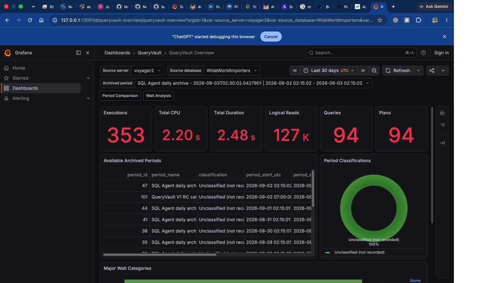
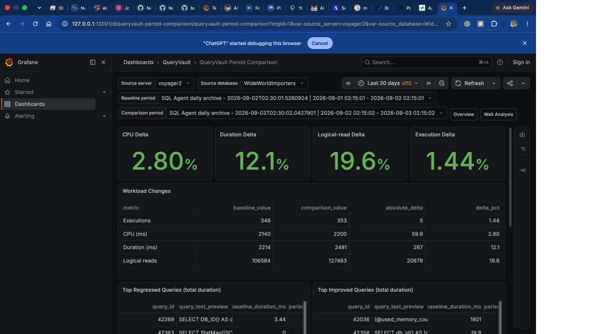
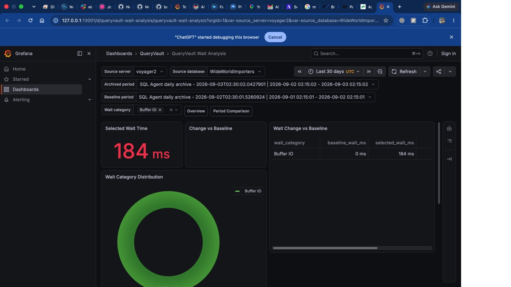
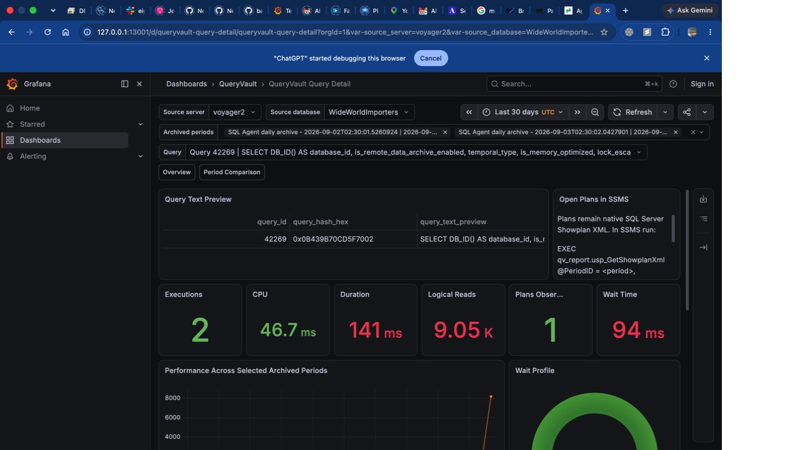

# QueryVault

A SQL Server database project for preserving, organizing, and analyzing historical Query Store data.

QueryVault copies Query Store information from one or more source databases into a centralized archive. It is designed to support longer-term performance analysis when the source database's built-in Query Store retention window is not enough. The project combines T-SQL, SQL Server Data Tools project structure, PowerShell deployment helpers, table partitioning, clustered columnstore indexes, and SQL Server Agent automation.

## A 90-second project tour

**The problem:** SQL Server Query Store history can roll off, be cleared during database refreshes or load-test resets, or disappear as storage limits are reached. This can erase the baseline before a quarter-long optimization effort has finished.

**The engineering response:** QueryVault captures selected completed Query Store intervals **before they disappear**, preserves comparable baseline and follow-up periods in a separate SQL Server archive, controls retention through RunID-based partition management, and exposes stable SQL reporting objects to Grafana. It is an archive and analysis project, **not** a replacement for Query Store or a live monitoring service.

**What a reviewer can verify:** T-SQL procedures, a SQL database project, partitioned columnstore tables, protected retention, SQL Agent scheduling, a least-privilege `qv_report` contract, Grafana dashboards, and documented deployment/validation checks.

### Screenshots from a validated SQL Server lab

These are actual September 2026 captures using the WideWorldImporters sample database, not conceptual mockups. They are included in source control so the project can be reviewed without access to my lab.

| Historical workload overview | Archived baseline comparison |
| :---: | :---: |
| [](docs/images/grafana-overview-period.jpg) | [](docs/images/grafana-period-comparison.jpg) |
| **Overview:** retained queries, plans, CPU, duration, reads and waits | **Period comparison:** query-level regressions, improvements and workload changes |
| Wait analysis | Query detail |
| [](docs/images/grafana-wait-analysis.jpg) | [](docs/images/grafana-query-detail.jpg) |
| **Wait analysis:** investigate shifts in wait categories | **Query detail:** examine a query across saved archive periods |

*All four images are actual September 2026 lab captures from the WideWorldImporters sample database. They are not fabricated production outcomes. See the [screenshot evidence and capture notes](docs/SCREENSHOT_PLAN.md) and [validation report](docs/VALIDATION_REPORT.md).*

### How the pieces fit together

```text
SQL Server database (Query Store)
              |
      Scheduled T-SQL capture
              |
              v
QueryVaultDB: metadata + RunID-partitioned historical facts
              |
       qv_report SQL contract
              |
              v
       Grafana OSS dashboards
  (period trends, comparisons, waits, queries)
```

### Start with the evidence

| Looking for | Review this |
| --- | --- |
| Why it matters | [Preserving load-test baselines and comparing July to October](docs/USE_CASES.md) |
| Architecture and tradeoffs | [Architecture](docs/Architecture.md) and [current implementation boundary](docs/CURRENT_STATE.md) |
| T-SQL and database project | [QueryVault source](QueryVault/) and [stored procedures](QueryVault/StoredProcedures/) |
| Reporting and observability | [Grafana setup](docs/Grafana-Setup.md) and [provisioned dashboards](grafana/) |
| Installation and safety | [Installation](docs/Installation.md), [operator guide](docs/QueryVault-Guide.md) |
| Testing and real validation | [September 2026 validation report](docs/VALIDATION_REPORT.md) |
| Product context | [QueryVault at Netherwood Data Partners](https://netherwooddatapartners.com/products/queryvault/) |

**Validation boundary:** The September 2026 release candidate was deployed and exercised in my Voyager2 lab. The report records successful archive preservation, partition lifecycle checks, reporting tests, and all 49 Grafana template/panel queries. It does not certify unrestricted production deployment or graphical SSMS plan rendering. See the [full acceptance report](docs/VALIDATION_REPORT.md) for exact results and limitations.

---

> **Project status:** Active. Core archiving and retention are implemented. The
> version-controlled Grafana V1 package and `qv_report` API are implemented and
> validated against a production-shaped archive on Voyager2. The guarded
> production workflow has deployed the current `master`; review
> [current state](docs/CURRENT_STATE.md) before subsequent changes.

## Why I built this

The motivating use case was preserving Query Store evidence from load tests and database refreshes, then comparing baseline and later performance after substantial tuning or technical-debt work. Think of a July baseline and an October follow-up after a quarter of changes. If the original database is overwritten or its Query Store history ages out, the baseline disappears unless it was captured beforehand. [See the detailed before-and-after story](docs/USE_CASES.md).

SQL Server Query Store is extremely useful for investigating regressions and understanding workload behavior, but its data can age out or be removed as storage limits are reached. QueryVault explores a practical solution: periodically archive that performance history into a purpose-built database where it can be retained, protected, queried, and maintained independently.

The project demonstrates database design and administration skills including:

- SQL Server Query Store internals
- T-SQL stored procedure development
- Partition functions, partition schemes, and partition switching
- Clustered columnstore storage for historical analytics
- Metadata-driven configuration and retention
- Dynamic SQL and cross-database operations
- SQL Server Agent job automation
- PowerShell-assisted deployment
- SQL Server Data Tools project organization
- Operational documentation and troubleshooting

## Key capabilities

- **Centralized Query Store archive** — preserves queries, query text, plans, runtime statistics, runtime intervals, and wait statistics.
- **Partitioned storage** — organizes archive data by run identifier for efficient maintenance.
- **Columnstore compression** — supports compact storage and analytical query patterns.
- **Metadata tracking** — records archive windows, source databases, status, row counts, retention dates, and protected runs.
- **Configurable retention** — supports per-database scheduling and retention settings.
- **Protected archives** — a `DoNotDelete` flag can preserve important investigation snapshots.
- **Automated execution** — includes SQL Server Agent job templates for individual or multiple databases.
- **Deployment options** — supports SSDT/database-project deployment, SQLCMD, PowerShell, or ordered manual execution.
- **Operational reporting** — includes procedures and sample queries for archive summaries, storage monitoring, and troubleshooting.
- **Stable reporting API** — exposes supported analytics through `qv_report` without coupling clients to internal tables.
- **Grafana OSS dashboards** — provisions the native Microsoft SQL Server datasource and four V1 dashboards; no custom plugin or plan renderer.

## Architecture

A typical workflow is:

1. Register a source database in QueryVault.
2. Select an archive time window.
3. Copy Query Store entities into archive tables under a shared `RunID`.
4. Record counts, execution status, retention, and protection metadata.
5. Query the retained history for performance investigations.
6. Switch and truncate eligible partitions when old runs reach their retention date.

The archive covers these major Query Store entities:

- `query_store_query_text`
- `query_store_query`
- `query_store_plan`
- `query_store_runtime_stats_interval`
- `query_store_runtime_stats`
- `query_store_wait_stats`

## Repository layout

`QueryVault/` contains the SQL database project and detailed technical documentation.

| Path | Purpose |
| --- | --- |
| `QueryVault/Tables/Core/` | Configuration and archive-run metadata |
| `QueryVault/Tables/QueryStore/` | Partitioned archive tables |
| `QueryVault/Tables/PartitionMaintenance/` | Matching tables used for partition-switch maintenance |
| `QueryVault/StoredProcedures/` | Initialization, archiving, reporting, and partition-management logic |
| `QueryVault/Partitions/` | Partition function and partition scheme definitions |
| `QueryVault/Jobs/` | SQL Server Agent job templates |
| `QueryVault/Scripts/` | Deployment, compatibility, and Query Store setup utilities |
| `QueryVault/Views/` and `QueryVault/Schemas/` | Stable `qv_report` reporting contract |
| `QueryVault/Security/` | DBA bootstrap and least-privilege Grafana user grants |
| `QueryVault/Tests/` | Read-only correctness and reporting reconciliation checks |
| `grafana/` | Version-controlled datasource and dashboard provisioning |
| `docs/` | Architecture, operations, reporting, validation, and screenshot plans |
| `QueryVault/README.md` | Full installation, usage, maintenance, and troubleshooting guide |

Start with the [detailed QueryVault documentation](QueryVault/README.md) for commands and examples.

For the supported Grafana OSS reporting integration, see the [reporting plan](docs/GRAFANA_REPORTING_PLAN.md) and [Grafana setup guide](docs/Grafana-Setup.md). Visualization queries use the stable `qv_report` schema rather than QueryVault's internal tables. The [architecture](docs/Architecture.md), [installation guide](docs/Installation.md), [operator guide](docs/QueryVault-Guide.md), and [validation report](docs/VALIDATION_REPORT.md) describe the complete path.

## Requirements

- SQL Server 2016 or later
- Query Store enabled on each source database
- SQL Server Agent for scheduled jobs (optional)
- SQLCMD or PowerShell for the assisted deployment paths (optional)
- Appropriate permissions for deploying the archive database and reading Query Store data
- Sufficient storage for the chosen retention period

SQL Server behavior and permissions vary by version and environment. Validate the deployment scripts, database names, filegroup strategy, job ownership, and retention settings before production use.

## Getting started

1. Clone or download the repository.
2. Review [QueryVault/README.md](QueryVault/README.md).
3. Deploy to an isolated development or test SQL Server instance.
4. Enable Query Store on a test source database if needed.
5. Register the source database with `usp_InitializeDatabase`.
6. Run a small manual archive with `usp_ArchiveQueryStore`.
7. Validate row counts and results with `usp_GetArchiveSummary`.
8. Configure automation only after the manual workflow succeeds.

Example initialization:

```sql
EXEC QueryVaultDB.dbo.usp_InitializeDatabase
    @DatabaseName = N'YourDatabase',
    @DefaultDaysToArchive = 30,
    @ScheduleType = N'Daily',
    @ScheduleTime = '02:00:00',
    @DefaultRetentionDays = 365;
```

Example manual archive:

```sql
EXEC QueryVaultDB.dbo.usp_ArchiveQueryStore
    @SourceDatabaseName = N'YourDatabase',
    @RunName = N'Initial test archive',
    @DoNotDelete = 1;
```

`usp_ArchiveQueryStore` accepts either an exact UTC window through
`@StartDateTime` and `@EndDateTime`, or a relative safely completed duration
through `@LookbackMinutes` (`60` for one hour, `1440` for one day). Supported
SQL Agent jobs resume from the latest completed endpoint so a failed run does
not leave an uncollected gap.

## Safety notes

- Test restores and deployments outside production first.
- Use least-privilege accounts for deployment and scheduled execution.
- Review SQL Agent job owners and proxy requirements.
- Size the archive using realistic Query Store volumes.
- Monitor partition availability before the configured range is exhausted.
- Confirm retention requirements before deleting archive runs.
- Do not commit credentials, connection strings, production server names, or customer data.

## What this project showcases

For reviewers and prospective employers, this repository is intended to show how I approach a database engineering problem end to end: identifying an operational gap, designing a metadata-driven schema, implementing automation and maintenance paths, documenting usage, and accounting for deployment and support concerns.

Areas of focus include SQL Server performance engineering, database reliability, maintainable T-SQL, automation, and clear technical documentation.

## Roadmap

Potential future enhancements include:

- Automated integration tests against disposable SQL Server instances
- CI validation for the SQL database project
- More configurable filegroup placement and partition growth
- Retention cleanup orchestration with dry-run reporting
- Authoritative period classification behind the existing nullable reporting column
- Release packaging and versioned upgrade scripts

## Contributing

Issues and pull requests are welcome. If proposing a change, please describe the SQL Server version used, the deployment path tested, and any compatibility considerations.

## License

No open-source license has been selected yet. The source is publicly visible for review and portfolio purposes; reuse rights are not granted unless a license is added later.
