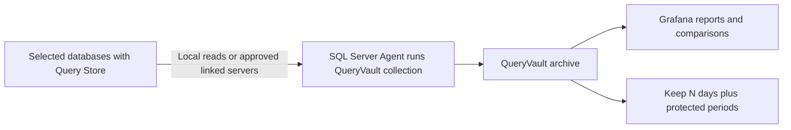

# QueryVault setup and use review

Prepared November 21, 2026. This is the proposed user experience for review, with the current implementation limits called out below. It is not an instruction to upgrade either Voyager machine today.

QueryVault saves the query performance history that a database's Query Store would eventually discard. You choose the databases, the periods to collect, and how long to keep them. You can compare those periods later and protect important baselines indefinitely.

## Where the project stands

| Part | Position today |
| --- | --- |
| Capture and reporting | A new [Voyager 1 sqlsim demonstration](SQLSIM_END_TO_END_2026_11_21.md) passed: 100 workload executions matched QueryVault's saved reporting metrics exactly. The four existing Grafana dashboards have separate historical lab validation. |
| Latest improvements | Registry tables, protection notes, retention fixes and readiness tools are in draft [PR 56](https://github.com/stevewittek/Databases/pull/56). The candidate is deployed only to the new isolated Voyager 1 demo archive; existing archives remain unchanged. |
| Remote sources | T-SQL with linked servers is the selected direction. Registry integration, remote ingestion and restart-safe checkpoints are still being built. |
| MotionRelay in Azure | A real encrypted connection and Query Store metadata checks succeeded. No MotionRelay history has been imported into QueryVault. Unattended access is still pending. |
| Existing Voyager installations | Voyager 1's archive job has a diagnosed legacy partition problem; repair is pending. Voyager 2's current database and backup state could not be verified. |
| Release readiness | We can review the workflow and test the local foundation in an isolated lab. The complete multi-server installation is not yet ready to use. |

Latest checked code before this documentation: `7ba56e8`. Seven CI checks passed; builds are not proof of live operation on every supported database version. See the [Azure](AZURE_SOURCE_READINESS_2026_11_21.md), [Voyager](VOYAGER_READINESS_2026_11_21.md) and [candidate validation](REGISTRY_VALIDATION_2026_11_20.md) reports for evidence boundaries.

## How you would use the completed version

The following walkthrough assumes the pending work has been finished and accepted. Configuration would initially use SQL scripts in SSMS; there is no setup website. Grafana is the reporting interface.

### 1 Choose where QueryVault runs

Use a SQL Server host for QueryVault's database and collection procedures. SQL Server Agent starts the scheduled work on that host. The sources can be databases on the same instance or approved remote SQL Server and Azure SQL databases.

For the first review, assume the archive also lives on that SQL Server. Hosting the archive itself in Azure SQL Database remains a separate decision. This diagram does not establish that destination as supported.

Deploy the package for that server into an empty archive database. A populated existing archive needs the reviewed upgrade path; the fresh-install package is not an upgrade script. See [installation mechanics](PORTABLE_BUILD.md).

### 2 Add the databases you want to retain

Register each database explicitly. Multiple databases can share one server entry, but each gets its own collection and retention settings. Nothing should automatically enroll every database it can see.

For example, the completed configuration would describe:

| Setting | Example for review |
| --- | --- |
| Source | A friendly label, exact database name, server address and port |
| Connection | Same instance, or an approved linked-server reference |
| Authentication | An approved credential reference; no password in the setup script |
| Collection period | One completed day |
| Retention | 30 days, as an example you can change |
| Protection | Important saved periods can be pinned with a note |
| Initial state | Collection disabled until its connection test passes; automatic deletion disabled |

Credential storage is still awaiting your decision. The recommended T-SQL design stores encrypted linked-server passwords in SQL Server and references the connection from QueryVault. Keeping encrypted passwords inside QueryVault instead requires a different design. Neither promises protection against a fully privileged server administrator. See [the decision](TSQL_COLLECTION_DIRECTION.md).

### 3 Test the connection and make one manual capture

Check the exact target, encrypted connection, execution account and Query Store availability. Then capture a small completed period and confirm the source, start/end times, status and saved metrics. A successful connection alone is not a successful archive.

QueryVault saves query text, plans, execution statistics and available waits. It does not copy the application's business tables. Query text can still contain sensitive values, so archive access needs control. Query Store records aggregate performance over intervals; it is not a recording of every application request. [Microsoft's collection overview](https://learn.microsoft.com/en-us/sql/relational-databases/performance/how-query-store-collects-data).

### 4 Schedule collection

After the manual capture reconciles, enable the SQL Agent job. The intended experience is to collect completed periods, resume after an interruption, report missing coverage and avoid counting retries twice.

The daily boundary and job time need to be chosen explicitly. A rolling 24-hour window is different from yesterday's calendar day. The current scheduler templates and new registry are not yet one integrated setup flow.

### 5 Review results and keep useful baselines

Connect Grafana to QueryVault using its reporting account. Open the overview, period comparison, wait analysis or query-detail dashboard. Select a database and comparable periods to inspect CPU, duration, reads, executions, waits and plan changes.

For example: save a baseline, make one change in a test database, repeat the same workload, then compare before and after. Pin the baseline with a note such as “Before November index change.” A pinned period stays even after it ages beyond normal retention. Pinning does not create an independent backup.

The existing comparison dashboards support investigation. Automated regression ranking and a new regression dashboard are later work.

### 6 Turn on retention after reviewing its preview

Configure how many recent days to keep, inspect the proposed deletions, and only then enable automatic cleanup. With 30 days selected, expired unprotected periods are eligible; pinned periods remain with their notes.

Cleanup uses partition switching and truncation. The current implementation partitions by archive run, not by calendar day. The completed product must reconcile that design with daily periods and many sources before we call it scalable. Pinned data also needs space; a capacity limit must never silently delete it.

### 7 Check health and recovery

Check the last successful period for each source, coverage gaps, failed runs, archive space and protected periods. Back up QueryVault and the selected credential recovery material, and test a restore separately from collection.

## The first review and demonstration

Use an isolated sample database: register it, generate a known workload, archive a closed period, inspect the report, pin it with a note, and preview retention. Then test failure recovery and measured load. The [test plan](TEST_AND_LOAD_REVIEW.md) gives the sequence and success criteria.

Before unattended remote collection, decide credential storage and confirm the initial archive location. Before scheduling, decide whether a “day” means UTC or a named local timezone, the run time, and each source's retention days. Monthly benchmark automation remains deferred. These decisions are not assumed by this guide.
